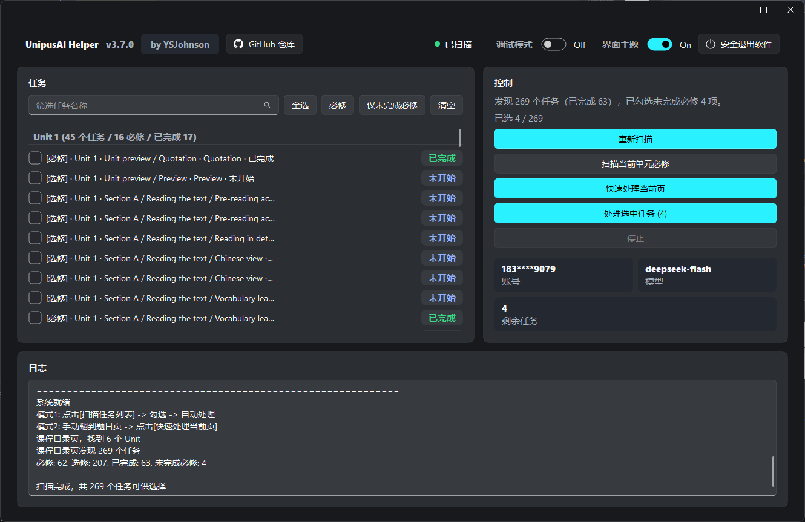
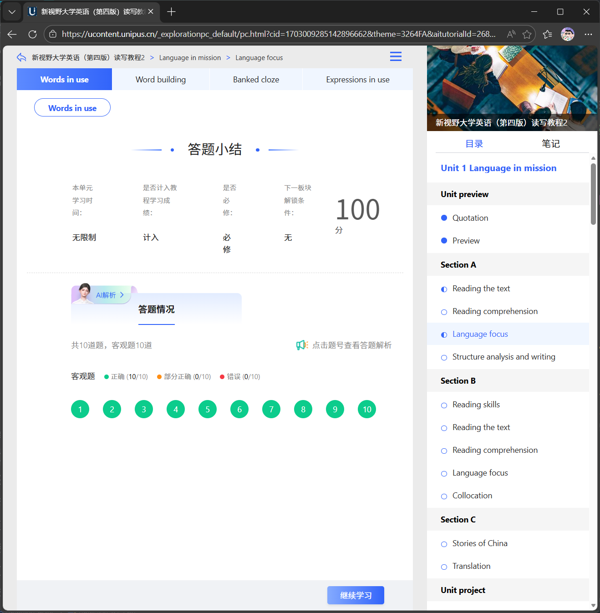
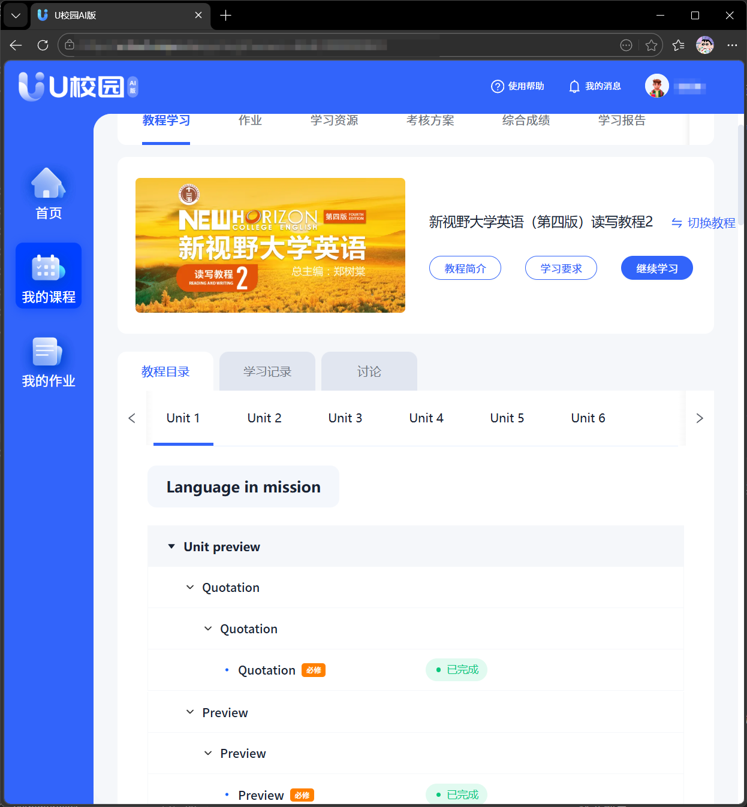
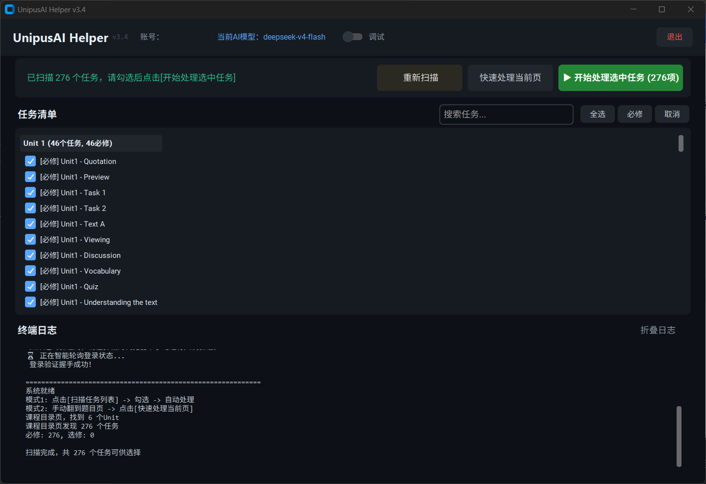
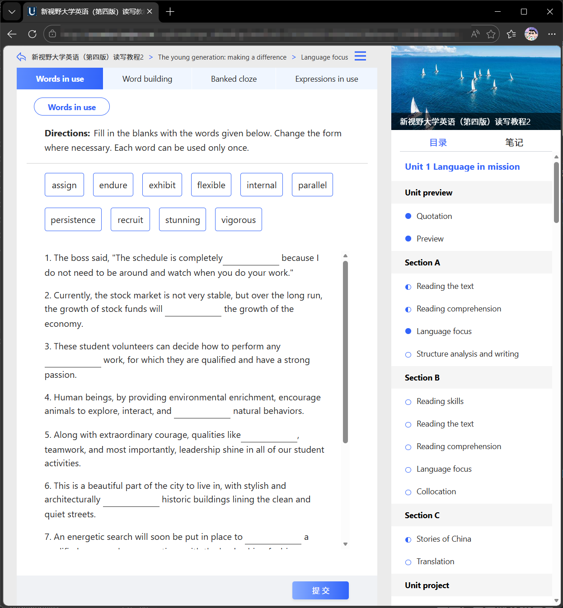
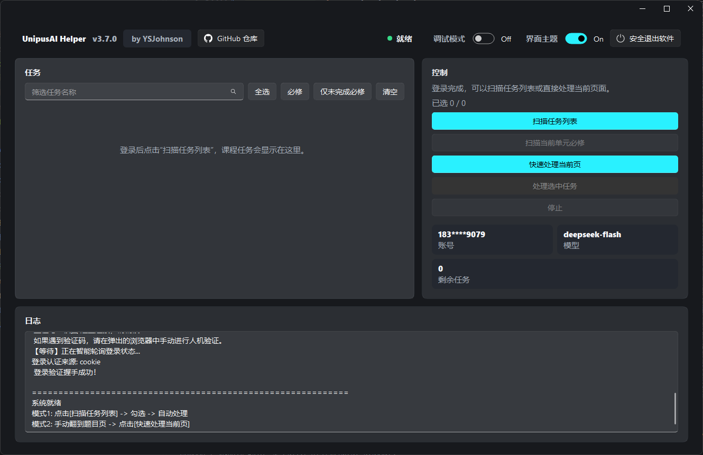
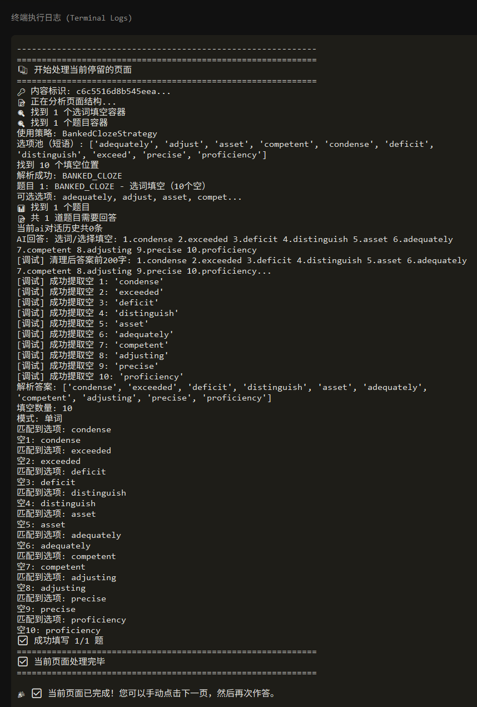

# UnipusAI-Helper

<p align="center">
  
</p>

<p align="center">
  基于 Selenium、Fluent UI 与 OpenAI 兼容接口的 U 校园 AI 版刷课工具
</p>

<p align="center">  
  
  
  
  
</p>

原 `UnipusAI_Plus` 项目已彻底重构为 `UnipusAI-Helper`。

## 简介

`UnipusAI-Helper` 是从早期 `UnipusAI_Plus` 重构而来的桌面版工具，当前版本为 `3.6.0`，主程序为 `UnipusAI_Helper.py`，配置编辑器为 `config_editor.py`，界面为 Fluent 风格。项目重点在于更稳定的 GUI 体验、多任务的批量处理、单页面的手动处理。

---

## 特性

- GUI 控制台：显示任务清单、运行状态、实时日志和调试开关。
- 双模式处理：支持“扫描任务列表”批量处理，也支持“快速处理当前页”。
- 多题型处理：支持单选、多选、填空、写作、选词填空、拖拽排序、下拉选择、词汇测试、听力填空、听力选择、视频选择、视频任务、视频弹窗题、词汇闪卡、Self-check 词汇勾选、My voice 文字作答。
- 音视频辅助：支持本地 Whisper 转写。
- 环境检查：启动时检查 Edge、FFmpeg、网络和运行环境。
- 配置编辑器：提供独立 GUI 编辑器，减少手动修改 JSON 出错的概率。

---

## 使用方法

```powershell
git clone https://github.com/YSJohnson/UnipusAI-Helper.git
cd UnipusAI-Helper
py -m venv .venv
.venv\Scripts\python.exe -m pip install -r requirements.txt
.venv\Scripts\python.exe config_editor.py
.venv\Scripts\python.exe UnipusAI_Helper.py
```

如果系统没有 `py` 命令，可将创建虚拟环境的命令改为 `python -m venv .venv`。先运行配置编辑器生成 `config.json`，保存后再启动主程序。

如需跳过环境检查：

```powershell
.venv\Scripts\python.exe UnipusAI_Helper.py --skip-check
```

---

## 配置说明

项目使用 `config.json` 作为本地配置文件，建议使用配置编辑器而不是手动修改。

```json
{
  "username": "",
  "password": "",
  "url": "https://uai.unipus.cn/sso/index.html?service=https%3A%2F%2Fucloud.unipus.cn%2Fhome",
  "api_key": "",
  "base_url": "",
  "model": "",
  "max_tokens": 8192,
  "temperature": 0.3,
  "token_full": "",
  "debug_mode": false
}
```

| 字段 | 必填 | 说明 |
| --- | --- | --- |
| `username` | 是 | U 校园 AI 版账号，用于自动登录 |
| `password` | 是 | U 校园 AI 版密码，用于自动登录 |
| `url` | 否 | 登录入口，留空或保持默认值即可 |
| `api_key` | 是 | 大模型接口密钥 |
| `base_url` | 是 | OpenAI 兼容接口地址，例如 `https://api.siliconflow.cn/v1` |
| `model` | 是 | 接口支持的模型名称 |
| `max_tokens` | 否 | 最大 token 数，保持配置编辑器生成的默认数值即可 |
| `temperature` | 否 | 生成温度，保持默认数值即可 |
| `token_full` | 否 | 认证兜底；支持旧版完整 `__token` JSON 或 U校园 5.0 的 JWT，正常登录时留空 |
| `debug_mode` | 否 | 是否开启调试日志，默认 `false` |

---

## 使用指南

1. 配置好基础信息，启动主程序并等待环境检查完成。
2. 程序会自动打开浏览器并执行登录流程。
3. 如果遇到验证码或人机验证，需要在浏览器中手动完成。
4. 系统就绪后，控制台显示系统就绪即为登录成功。



5. 先在浏览器点击 `我的课程` -> `选择你要刷的课程`，打开到展示教程目录的页面。



6. 可点击“扫描任务列表”，脚本会自动扫描所有单元所有任务并展示出来，你可以自行选择需要刷的任务，或一键选择所有必修任务。



7. 点击 `开始处理选中任务` 即可批量全自动处理选中任务。

8. 或者手动打开需要做的某一个页面，进入到题目页面，点击“快速处理当前页”，脚本则只做当前页面。



9. 做完后脚本会在延迟几秒后自动提交。  
这是为了模拟真人的思考时间，避免用时过短引起怀疑。  
控制台会提示当前页面处理完毕并自动提交作业。





---

## 新版 ipublish 播放器教材

`新农科大学英语` 这类 course-v3 教材已完成初步适配，感谢 [Miku196](https://github.com/Miku196) 提供的账号。

支持的题型：

| 题型 | 播放器标记 | 处理方式 |
| --- | --- | --- |
| 单选 / 多选 | `single_choice_group` / `multiple_choice_group` | 按选项字母点击 |
| 判断 | `true_false_group` | 点击 T / F |
| 填空 | `fill_blanks_group` | 按空号写入 `input`（支持一个组里多道小题、多个空） |
| 选词填空 | `fill_blanks_choice_group` | 从候选词中选择后写入 |
| 下拉填空 | `fill_blanks_dropdown_group` | 点开空位抓取候选列表后交给模型选择，按文本精确点选 |
| 简答 / 翻译 / 写作 | `short_answer_group` / `translation_group` / `writing_group` | 写入文本作答框 |

会跳过并提示的题型：口语录音（`oral_personal_state_group`）、附件上传
（`multi_media_upload_group`）、连线匹配（`text_match_group`）、小组讨论（`discussion_group`）。
纯阅读材料（`rich_text_read_group`）不答题，但会作为上下文提供给模型。

使用方式与旧版一致

---

## 题型适配投稿

我本身能接触到的教材有限 能适配的教材题型也有限 所以不能保证所有题型都适配 目前已知新视野大学英语1 2 3册是基本全部适配 新农科大学英语完成初步适配 其他教材可能会出现不适配的情况。

如果你遇到暂不支持的新题型/新教材 可以在 issue 中投稿页面结构 或者是联系我的邮箱私信发送账号密码（我会在最小范围内使用 这也是最快最高效的方法） 我会在有可复现材料时优先适配 也将会帮助项目变得更加完善。

材料越完整，越容易适配；只有一句“这个题型不支持”的 issue 无法判断页面结构 将被作为无效 issue 关闭。

---

## 致谢

感谢优秀的开源土壤。
感谢 [UnipusAI](https://github.com/Zzj-klwgxdz/UnipusAI) 项目作者 [Zzj-klwgxdz](https://github.com/Zzj-klwgxdz)。这是纯命令行 + 原生 HTTP 实现的 Rust 版 U 校园 AI 版刷课脚本。  
感谢原作者提供的强大解析器框架与思路，特别是其针对 U 校园 AI 版登录认证状态的处理机制。

---

## Star⭐ 承蒙厚爱

[](https://www.star-history.com/#YSJohnson/UnipusAI-Helper&Date)

---

## License

本项目采用 **GNU Affero General Public License v3.0 (AGPLv3)**。  
你可以自由使用、修改和分发本项目，但任何修改版或衍生作品必须以相同的 AGPLv3 协议开源。即使是作为网络服务运行（SaaS），也必须向用户公开完整的源代码。

> [!WARNING]
> 本项目仅用于 Python 自动化、Web 页面交互、语音识别与大模型接口接入的学习研究。请遵守学校、课程平台和相关法律法规，不要将其用于违反平台规则或影响教学公平的用途。
