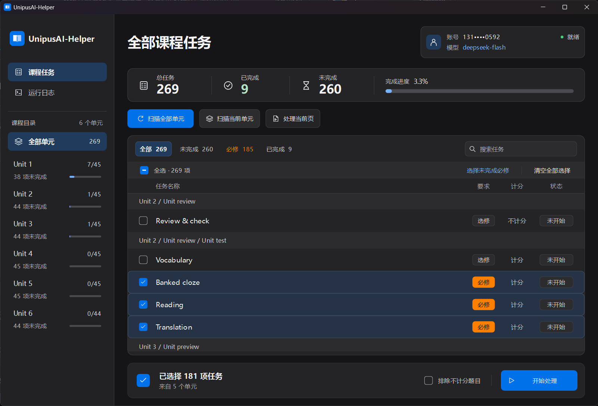
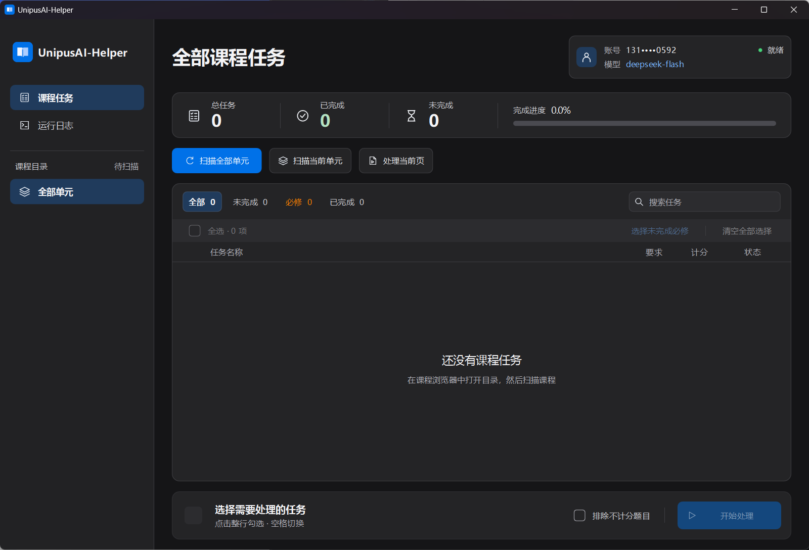
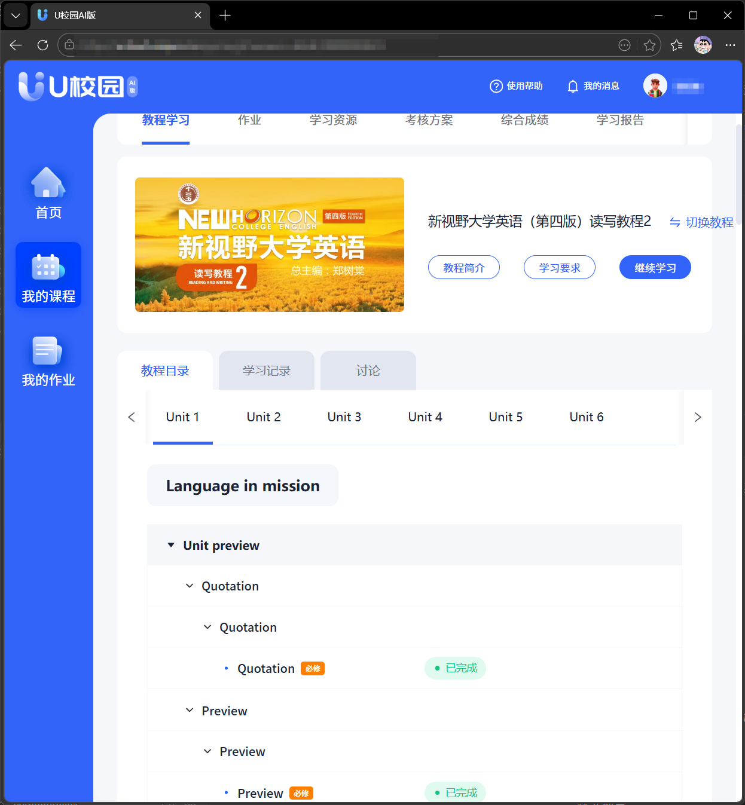
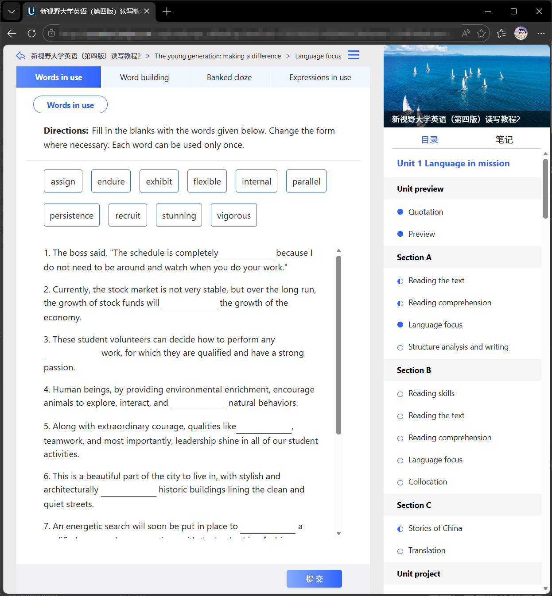
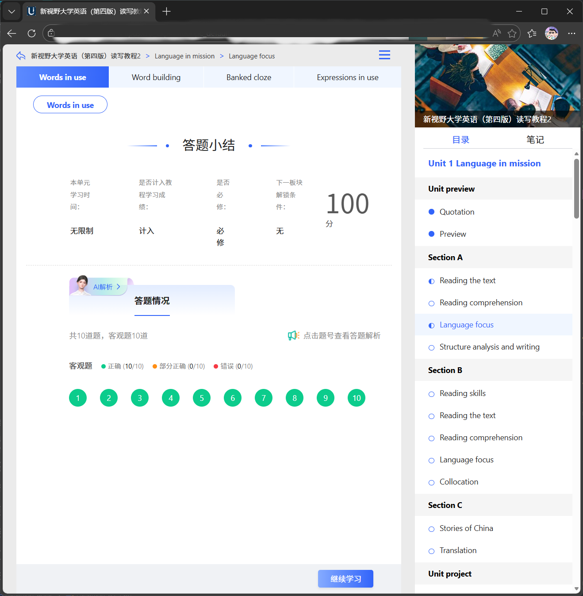

# UnipusAI-Helper

<p align="center">
  
</p>

<p align="center">
  基于 Selenium、PySide6 / QML 与 OpenAI 兼容接口的 U 校园 AI 版刷课工具
</p>

<p align="center">  
  
  
  
  
  
</p>

---

## 特性

- **多题型处理**：支持选择、填空、阅读、翻译、写作及音视频、录音等等题型，支持自动提交。
- **批量与单页处理**：可扫描全部单元或当前单元批量处理，也可直接处理当前页面。
- **任务筛选**：默认选择未完成必修，支持搜索、状态筛选和排除不计分任务。
- **断点续跑**：完成一项自动取消勾选，停止后保留剩余选择，方便继续处理。
- **桌面工作台**：集中查看课程进度、任务列表和运行日志，附带独立配置编辑器。

---

## 项目结构

根目录保留主入口、配置编辑器、配置、依赖清单与项目说明，辅助代码和资源按用途归类：

```text
UnipusAI-Helper/
├── UnipusAI_Helper.py          # 主程序入口
├── config_editor.py           # 独立配置编辑器
├── config.example.json        # 配置示例
├── config.json                # 本地配置（不提交）
├── requirements.txt           # Python 依赖
├── README.md
├── LICENSE
├── unipus_helper/             # 业务模块与原生界面
│   ├── audio_recognizer.py    # 音频转写
│   ├── environment_checker.py # 环境检查
│   ├── course_catalog.py     # 课程目录扫描
│   ├── task_grading.py       # 计分状态识别与筛选
│   ├── workbench_controller.py # 任务状态、调度与日志
│   ├── native_ui.py          # Python / QML 桥接
│   ├── paths.py              # 项目与资源路径
│   └── qml/                  # 原生界面组件、主题与图标
├── scripts/                  # macOS / Linux 辅助脚本
├── docs/                     # 工作台说明与截图
├── logs/                     # 本地运行日志（不提交）
└── config-backups/           # 本地配置备份（不提交）
```

## 使用方法

```powershell
git clone https://github.com/YSJohnson/UnipusAI-Helper.git
cd UnipusAI-Helper
py -m venv .venv
.venv\Scripts\python.exe -m pip install -r requirements.txt
.venv\Scripts\python.exe config_editor.py
.venv\Scripts\python.exe UnipusAI_Helper.py
```

如需跳过环境检查：

```powershell
.venv\Scripts\python.exe UnipusAI_Helper.py --skip-check
```

### macOS

先装好运行环境，之后用脚本启动即可（脚本会自动检测并初始化 `.venv`）：

```bash
brew install ffmpeg                     # 语音转写需要
brew install --cask microsoft-edge      # 程序驱动的是 Edge

./scripts/config.sh                     # 打开配置编辑器，生成 config.json
.venv/bin/python UnipusAI_Helper.py      # 启动主程序
```

也可以在访达里双击 `scripts/UnipusAI-Helper.command`。首次双击若提示「无法打开」，右键 →「打开」，
或在终端补一下执行权限：`chmod +x scripts/config.sh scripts/UnipusAI-Helper.command`。

原生工作台保留系统标题栏与窗口操作；Windows 使用系统边框，macOS 使用系统红绿灯。

---

## 配置说明

项目使用 `config.json` 作为本地配置文件，建议使用配置编辑器而不是手动修改。

```json
{
  "username": "",
  "password": "",
  "url": "https://uai.unipus.cn/sso/index.html?service=https%3A%2F%2Fucloud.unipus.cn%2Fhome",
  "api_key": "",
  "base_url": "",
  "model": "",
  "max_tokens": 32768,
  "temperature": 0.3,
  "token_full": "",
  "debug_mode": false
}
```

| 字段 | 必填 | 说明 |
| --- | --- | --- |
| `username` | 是 | U 校园 AI 版账号，用于自动登录 |
| `password` | 是 | U 校园 AI 版密码，用于自动登录 |
| `url` | 否 | 登录入口，留空或保持默认值即可 |
| `api_key` | 是 | 大模型接口密钥 |
| `base_url` | 是 | OpenAI 兼容接口地址，例如 `https://api.siliconflow.cn/v1` |
| `model` | 是 | 接口支持的模型名称 |
| `max_tokens` | 否 | 最大 token 数，默认 `32768`。推理型模型会把预算烧在思考上，代码层下限也是 32768；模型不接受时会自动减半重试 |
| `temperature` | 否 | 生成温度，保持默认数值即可 |
| `token_full` | 否 | 认证兜底；支持旧版完整 `__token` JSON 或 U校园 5.0 的 JWT，正常登录时留空 |
| `debug_mode` | 否 | 是否开启调试日志，默认 `false` |
| `tts_engine` | 否 | 录音题语音合成后端：`auto`（默认，先 edge 后 sapi）/ `edge` / `sapi` / `off` |
| `tts_voice` | 否 | TTS 音色；留空用默认英语音色（`en-US-AriaNeural` / 系统英语语音） |
| `tts_proxy` | 否 | `edge-tts` 需要走代理时填，例如 `http://127.0.0.1:7890`；离线 `sapi` 不需要 |


---

## 使用指南

1. 配置好基础信息，启动主程序并等待环境检查完成。
2. 程序会自动打开浏览器并执行登录流程。
3. 如果遇到验证码或人机验证，需要在浏览器中手动完成。
4. 工作台右上角显示「就绪」即为登录成功。



5. 先在浏览器点击 `我的课程` -> `选择你要刷的课程`，打开到展示教程目录的页面。



6. 点击顶部「扫描全部单元」读取所有单元的任务；扫描完默认勾选**未完成必修**。
   只想扫描浏览器所在的单元时，直接点击旁边的「扫描当前单元」。


7. 点击「开始处理」批量处理选中任务，启动后自动切换到「运行日志」。每完成一项自动取消勾选并更新状态；
   点击「停止处理」后保留剩余选择，再次开始即可继续；手动停止或出错时不自动跳回，便于查看日志。

8. 或者手动进入题目页面，直接点击顶部「处理当前页」并确认。启动后自动进入日志，正常完成后同样自动返回任务列表。


9. 做完后脚本会在延迟几秒后自动提交。  
控制台会提示「已自动提交」；若页面按钮结构特殊没点中，会提示「请手动提交」。



---

## 更新日志

<details>
<summary><b>点击展开完整更新日志</b></summary>

<details>
<summary><b>v3.9.7（2026-11-13）</b>：新版视听说课程适配 / 录音与学习进度修复</summary>

- **录音与自评**：修复新版播放器窄窗口下的录音问题，支持自评量表题及已有选项的识别。
- **独立单元测试**：支持包含单选题的诊断测试，答题卡完整后统一提交；保留已有成绩和部分作答进度。
- **学习进度**：浏览任务正文并完整播放独立音视频及已提交题组内的音视频，以记录对应学习进度。
- **特殊任务提示**：AI 口语对话和作品上传提示在平台内处理；处理后请以课程目录的实际进度为准。

</details>

<details>
<summary><b>v3.9.6（2026-11-09）</b>：原生工作台重做 / 交互优化 / 项目目录整理</summary>

- **原生工作台**：使用 PySide6 / Qt Quick / QML，移除旧 React / Web 与 Fluent 工作台；不依赖 Node.js、UI 网页服务或额外的 UI 浏览器。独立配置编辑器仍使用 PyQt5 / Fluent Widgets。
- **目录整理**：业务模块与 QML 资源集中到 `unipus_helper/`，辅助脚本移入 `scripts/`，说明和截图移入 `docs/`；根目录保留主入口、配置编辑器、配置与依赖清单。
- **任务概览**：增加当前范围的任务总数、已完成 / 未完成数量、完成比例、单元侧栏进度、章节分组和独立运行日志。
- **字体与整行选择**：Windows 优先使用微软雅黑 UI，任务名 15px、小标签至少 13px；点击整行均可勾选，并补齐键盘导航、焦点反馈和长文本提示。
- **搜索与选择范围**：支持无结果一键恢复，保留当前单元与已选任务；全选只影响当前可选任务，提示隐藏选择数量，并明确「清空全部选择」的范围。
- **处理完成导航**：批量处理与「处理当前页」启动后自动进入日志，正常完成后返回任务列表；停止或出错时保留当前页，方便检查日志。
- **计分筛选修复**：修复开启「排除不计分题目」后，手动勾选或全选仍能重新选中不计分任务的问题；计分待确认的任务仍可选择。
- **交互回归**：使用本地示例任务通过 23 项 Windows Qt 回归测试，覆盖整行勾选、键盘 / 辅助功能、筛选恢复、计分排除、最小窗口尺寸，以及完成 / 停止 / 失败后的导航。

</details>

<details>
<summary><b>v3.9.5（2026-11-09）</b>：段落信息匹配 / 词汇卡跟读 / 计分任务筛选</summary>

感谢 [NovaJuly](https://github.com/NovaJuly) 贡献段落信息匹配、词汇跟读适配（#49 / #52），并提供从学习记录区分计分任务的方法，
以及 [longbeize](https://github.com/longbeize) 的问题反馈。

- **段落信息匹配**：支持 `Skimming and scanning`，按阅读段落字母填写各条陈述，支持同一段落重复选用。
- **词汇卡跟读**：`New words` / `Phrases and expressions` 使用页面原声逐卡跟读，无原声时朗读卡片上的词或短语。
- **完成与停止**：整组卡片的本次录音全部上传完成后才标记成功；翻卡或上传失败时保留未完成状态。
  从中间卡片开始会先返回第一张；点击停止后结束当前录音并停止后续卡片。
- **计分状态**：读取学习记录的 `scoreTaskFlag`，按单元标识、完整章节路径和任务名匹配，
  区分计分与不计分；路径重复或数据缺失时保留未知状态，不按题型猜测。
- **可选排除**：「排除不计分题目」默认关闭，启用后取消勾选明确不计分的任务，
  扫描默认勾选和批量选择会排除这些任务，计分未知的任务仍可选。
- **兼容回退**：记录读取失败不阻断目录扫描；扫描当前单元仅读取该单元的记录，保持当前单元。

</details>

<details>
<summary><b>v3.9.4（2026-11-08）</b>：修复纯音频练习与段落跟读 / 完善 AI 空回复重试（issue #41）</summary>

感谢 [HackerWang119](https://github.com/HackerWang119) 提供账号密码并反馈 issue #41，帮助复现与验证本次适配。

针对《新一代大学英语（提高篇）视听说教程 1》的 `iPractice / Practice` 补充适配：

- **Practice-1 纯音频练习**：不再被当成无题目页面跳过，按正常速度完整播放音频，
  自然结束后才标记完成；播放失败、停滞或点击停止时保留未完成状态，便于重试。
- **Practice-2 段落跟读**：识别段落播放器中的样音及原文，直接使用对应样音完成跟读；
  没有样音时使用 TTS 朗读给定段落，不再转写或生成无关的 AI 口语稿。
- **录音结果判定**：区分参考样音与用户录音回放，按录音按钮对应条目，
  避免错用回放音频或漏录后仍提交。
- **AI 空回复重试**：修复推理耗尽 token 返回空正文时，在预算已达 32768 后不再重试的问题；
  按配置次数使用简化问法重试，并保留取消与网关预算降级处理。
- **回归测试**：新增 24 项测试，覆盖音频完整播放、失败重试、停止、段落录音解析、
  AI 空回复重试及连线题解析与执行分支，并修正本地旧分类断言。

真实账号实测 Unit 3：`Practice-1` 完整播放 53.159 秒音频，`Practice-2` 跟读得分 82 并提交成功，
目录中两项均显示已完成；两项均未调用 AI 或 Whisper。本地全量回归测试 82/82 通过。

</details>

<details>
<summary><b>v3.9.3（2026-11-05）</b>：适配《理解当代中国》音视频与口语题 / 修复目录扫描与快速处理（issue #30）</summary>

针对《理解当代中国 大学英语视听说教程1》的 course-v3 播放器补充适配：

- **新版目录扫描**：兼容 `taskItemInnerLayout` 和 `nodeItemInnerLayout` 两种目录结构。
  播放器内可以直接扫描，自动返回本教材目录；只扫描当前单元时会定位到播放器所在单元，
  扫描结果保存目录地址，便于后续重新打开所选任务。
- **快速处理按当前视口定位**：手动滚动后，不再沿用 iframe 初始的 `Learning objectives` 锚点。
  一次只处理当前定位到的题组；批量处理仍按勾选任务的边界执行。
- **口语录音与样音跟读**：支持个人口语题、分页口语小题和句子跟读，处理准备倒计时、
  录音启动及上传确认；保留已有上传录音，避免将题目自带样音误判为已作答。
- **音视频材料预处理**：确认播放器实际播放后，将本地 Whisper 转写加入答题上下文；
  补充单题题干位于题组外的解析，短音频转写也能保留。播放或转写失败时不提交。
- **失败状态与重试**：处理失败不再标记任务完成；新单元内容定位等待延长至 30 秒，
  未处理完成时输出明确日志。口语稿提示词改为围绕实际题目组织内容。
- **语音依赖更新**：`edge-tts` 最低版本升至 `7.3.1`，解决实测旧版本请求语音服务返回 403 的问题。

本地验证覆盖真实账号的目录扫描、滚动后题组定位和分页跟读提交，
以及离线 Edge 中的 iframe、完整快速处理入口及新旧目录结构测试。
AI 对话练习和附件上传题仍需手动处理。

</details>

<details>
<summary><b>v3.9.2（2026-11-03）</b>：适配 macOS 运行 / 修复原生红绿灯与无边框窗口控制</summary>

合入 [@Twiikeyee](https://github.com/Twiikeyee) 的 [#35](https://github.com/YSJohnson/UnipusAI-Helper/pull/35)，
并补齐了几处会连带影响 Windows 的地方。作答逻辑没有改动。

- **非 Windows 不再因 `winsound` 启动即崩**：改为 `try/except` 降级，非 Windows 下走静音实现，
  Windows 仍然是真 `winsound`，行为不变。
- **环境检测认得 macOS 的 Edge**：新增 `/Applications/Microsoft Edge.app` 与 `PATH` 里的
  `msedge` / `microsoft-edge` 探测；非 Windows 缺 Edge 或 FFmpeg 时改为提示 `brew` 安装命令，
  不再傻乎乎去下 Windows 安装包（原来那样在 mac 上必然失败）。
- **macOS 恢复原生红绿灯**：启用系统标题栏按钮，红绿灯按标题栏实际高度纵向居中，
  全屏或缩放时不会跑偏；Windows 端依旧是无边框自绘。
- **`⌘M` / `⌘W` 与最小化按钮**：快捷键只在 macOS 注册（Qt 的 `Ctrl` 在 darwin 上映射到 Command），
  Windows 用户不会因为新增快捷键被 `Ctrl+W` 直接关窗；配置编辑器补了最小化按钮，两个平台都能用。
- **双击启动不再秒关窗口**：`UnipusAI-Helper.command` 去掉 `set -e`——原来程序一报错，
  脚本就退出了，后面那段「按任意键关闭窗口」永远执行不到，正是它想解决的场景。
- **PyQt5 提到 5.15.11**：更低版本在 Apple Silicon 上没有预编译轮子，会掉进源码编译。

Windows 端除了配置编辑器多一个最小化按钮，其余行为与 v3.9.1 一致。

</details>

<details>
<summary><b>v3.9.1（2026-10-29）</b>：任务列表改成多层折叠目录树 / 必修选修视觉区分 / 只保留深色主题</summary>

一次纯界面打磨，不改任何作答逻辑：

- **任务列表改成目录树**：以前一行是 `[必修] · Unit 1 · Section A / Reading the text /
  Pre-reading activities · Task 1 · 未开始` 这样一整条路径，路径一长尾巴就被省略号截掉，
  看不出到底是哪个任务点。现在按真实目录结构拆成多层，每一层都能点标题折叠/展开：

  ```
  ▾ Unit 1                    46 任务 · 8 必修 · 完成 18
    ▾ Section A                                    19 项
      ▾ Reading the text                            7 项
        ▾ Pre-reading activities                    2 项
          [选修] ☐ Task 1                    已完成
          [选修] ☐ Task 2                    已完成
  ```

  行内只留任务名本身（`Task 1`、`Text A`、`Words in use`），路径交给上层标题，
  长路径再也不会被截断；越深的层级字号越小、颜色越淡。
- **必修/选修区分更明显**：行首加彩色类型徽章——必修是琥珀底 + 暖黄加粗字形、橙色勾选框，
  选修是低对比灰色徽章 + 常规字重；不再只靠文本前缀里的 `[必修]` 区分。
- **任务行字号**：14px → 18px（随 `font_scale` 缩放），勾选框字体用 `setFont` 强制生效
  （qfluentwidgets 的 `CheckBox` 会忽略父级 QSS 的 `font-size`，这是以前字号调不大的根因）。
- **只保留深色主题**：移除顶栏的「界面主题」开关和整套浅色配色，不再需要切换。
- **搜索扩展到整条路径**：可以按任务名、章节名、Unit 名过滤；没有任何命中的层级整块隐藏，
  清空搜索后恢复原来的展开状态。

</details>

<details>
<summary><b>v3.9.0（2026-10）</b>：Exercise 1 词汇复用 / Exercise 2 主观录音题 TTS（issue #29）</summary>

感谢 [mctea01](https://github.com/mctea01) 提供账号密码并反馈 issue #29

接着 v3.8.0 的跟读适配，把 `After you view` 里剩下的两个子步骤补齐：

- **Vocabulary 对照表复用**：解析 `Vocabulary` 页的跟读行时，把「英文原词 + 中文释义」收进
  一份跨页缓存（`VocabularyStore`，按中文归一化后建索引，支持包含/近义变体命中）。
- **Exercise 1（中文括注 → 英文填空）不再让模型自由翻译**：题干里 `____ (老年大学)` 这类
  括注先按 Vocabulary 页的对照表锚定用词（逐空给出「空1: 老年大学 → senior citizen's college」），
  并要求「用词必须取自表里的写法，不许意译或换同义词」，写错搭配导致正确率低的问题就是这样解决的。
- **词形一律交给模型**：脚本只提供对照表，不做任何机械变位（不加 `-ing`、不拼 `-ed`、不改大小写）。
  提示词里明确「词形由你按句子语法判断——该用 `-ing` / `-ed` / 复数 / 首字母大写时就改，词干必须与表里一致」。
  这样 `… discovering new demands and ____ (释放新动力)` 会由模型自己写成 `unleashing new impetus`，
  遇到复数、派生词这类规则覆盖不到的变化也不会被脚本硬掰错。
- **Exercise 2（主观录音题）新增 TTS 作答**：这类题只有一个 02:00 计时录音按钮、没有原声可借。
  现在的流程是「模型写一段可直接朗读的英文口语稿 → TTS 合成 → 依旧冒充麦克风输入 → 自动点停止」。
  稿件长度按语速（约 2.4 词/秒）折算并裁到 110 秒以内，超长音频在浏览器侧按上限截断并做淡出。
- **双 TTS 后端**：默认 `auto`，先试 `edge-tts`（微软在线朗读，音色自然，可配代理），失败自动回退到
  Windows 自带 `System.Speech`（`sapi`，离线可用）；配置 `tts_engine` 可强制指定或 `off` 关闭。
- **录音按钮识别加兜底**：`Exercise` 主观题的录音按钮不一定带 `button-record`，主选择器找不到时
  依次尝试 `.button-record` / `.oral-record-btn` / `.record-btn` 等，避免整题被当成「没有输入框」跳过。
- **主观题也按分数判定**：自由作答停止后平台会先上传音频再评分（实测同一个 239 词语音拿到
  **100 分**），分数挂在 `.p-oral-personal-state` 上、不在录音按钮那一层，判定逻辑一并上扩到该层；
  没有分数时退回「出现可回放的 `<audio>`」判断，长录音最多等 120 秒。主观题只录一次，
  避免重录白白多花一分多钟。
- **实测（新视野视听说教程4 / Unit 2 Viewing China）**：Vocabulary 7 条跟读 7/7，得分
  95/96/94/97/96/95/96；Exercise 2 的 TTS 作答一次录完、评分 100；Exercise 1 的用词来自
  Vocabulary 对照表（`senior citizen's college` / `silver economy` / `unleash new impetus` /
  `smart elderly care`），词形由模型按句子语法调整，其中空 3 应为 `unleashing new impetus`。

| 题型 | 识别特征 | 处理方式 |
| --- | --- | --- |
| 跟读录音（Vocabulary / Exercise 1） | `.oral-study-sentence` 行 + `.record-icon.button-record` | 借题目自带原声冒充麦克风，逐条录音等评分 |
| 自由作答录音（Exercise 2） | 计时录音按钮（`02:00` + 点击结束录音），行内没有 `<audio>` | 模型写口语稿 → TTS 合成 → 同样注入麦克风 |
| 中文括注填空（Exercise 1） | 题干 `____ (老年大学)` | 命中 Vocabulary 对照表就直接填，未命中才走模型 + 对照表上下文 |

</details>

<details>
<summary><b>v3.8.0（2026-11）</b>：跟读/朗读录音题适配（issue #26）</summary>

- **新增跟读/朗读录音题**：新版视听说教材（`course-v2` 播放器）的 `Vocabulary`、`Exercise`
  里有一类题，页面给一句英文和它的原声，要求「听并跟读」，每条右侧是一个麦克风按钮，
  录完由腾讯智聆（SOE）打分。这类题以前会被整题跳过（找不到输入框），现在能自动做完。
- **实现方式**：不调用任何 TTS。把题目自带的原声（`audio.question-audio.audio-origin` 的
  `src`，`..._96k.mp3`）下载下来，在页面里 `decodeAudioData` 后接进
  `MediaStreamDestination`，并覆盖 `navigator.mediaDevices.getUserMedia` 把这条流冒充成
  麦克风输入，页面自己的录音器照常上传评分。
- **关键细节**：页面录音器在开始拉流后的前约 0.6 秒会丢块并把丢失部分补成静音，直接喂原始
  音频会得到「完整度 33%、总分 50」；在音频前面**垫 0.8 秒静音**即可完整通过，实测逐词
  100 分、总分 94–97。
- 录音题不需要模型给答案，走单独的作答分支：逐条录音 → 等评分回填 → 条数齐了再交卷；
  停止点击没生效时自动补点一次，漏答的条目在提交前补录。
- 录音题的原声就是题目本身，不再对它做 Whisper 转写，省掉一次无用的音频预处理。
- 启动参数补 `--use-fake-ui-for-media-stream`、`--autoplay-policy=no-user-gesture-required`，
  并在新文档注入阶段挂上麦克风注入脚本；`_create_driver` 增加广义 `except` 分支，兜住驱动
  握手超时（`urllib3 ReadTimeoutError`）后再降级兼容模式重试。

</details>

<details>
<summary><b>v3.7.1（2026-10）</b>：扫描当前单元重做 / 按钮层级修正 / 列表清理</summary>

- **「扫描当前单元」重做**：只读当前已经打开的单元，不再逐个点 Tab，也不会误扫成第 1 个单元；
  当前单元改用目录里的 `tabActive` / `sliderActive` 识别；
- **按钮层级对齐**：「扫描当前单元」与「扫描任务列表」同为主色按钮，登录完成后一起启用
  （之前它一直是置灰状态，点不动）；
- **消除歧义**：两个扫描按钮的文案固定不变，不再互相变成「重新扫描」；
  状态栏改为显示本次扫描范围，例如「范围：当前单元；发现 45 个任务…」；
- **列表清理**：重新扫描时先摘除旧控件再销毁，空状态提示不会再叠在任务列表上；
- 空列表提示文案同时提到「扫描任务列表」与「扫描当前单元」两个入口。

</details>

<details>
<summary><b>v3.7.0（2026-10）</b>：任务状态感知 / 断点续跑 / 匹配题与新题型适配 / 自动交卷</summary>

感谢 [iceqi717](https://github.com/iceqi717) 提供账号

**使用体验**

- 扫描时读取每个任务的「已完成 / 未开始 / 进行中」，任务行右侧显示状态标签；
- 新增「仅未完成必修」筛选，**扫描完默认只勾选未完成必修**；
- 每完成一个任务自动取消勾选并把状态改成「已完成」，停止后剩下的勾选就是还没做的，
  再点开始即从卡住的那题继续（断点续跑）；
- 新增「扫描当前单元必修」，只扫当前单元、不切换其它 Unit；
- 单元编号改用目录真实标题，`Course preview` 这类预习单元单列为「预备单元」，不再把后面的 Unit 挤乱；
- 界面字号整体放大、日志区额外放大到约 130%，分组标题加粗提亮；账号默认脱敏显示；
- 日志去掉 emoji，改用 `【请求】/【返回】/【等待】/【跳过】/【完成】` 等标签；AI 请求前后打印字数与耗时。

**答题能力**

- 新增**人物 A–F 匹配题**：按 `data-scoop-index` 切分陈述，模型只回字母，逐空写入；
- 选项题会把模型回填的选项原文反查成字母；本页没填好时自动二次修正；
- 空位多的填空题按 8 空分批提问，整批返回空就 8→4→2 对半拆，最后 1–2 空换短问法重试；
- 搭配题自动读取同题组的 `Learning` 页当答案上下文，并用「同前缀候选词」抑制误选；
- 题干印在输入框外的首字母会自动去掉再写入（`un`+`unhappy` → 写 `happy`）；
- 填完**自动提交**，日志提示「已自动提交」；点不中按钮会明确提示手动提交；
- `max_tokens` 默认 32768，代码层下限 32768，模型不接受时自动减半重试。

**旧版播放器（course-v2）新增题型适配**

| 题型 | 识别特征 | 处理方式 |
| --- | --- | --- |
| 人物 A–F 匹配 | 方向含 `match the people` / `Filling the blanks with A-F` | 按空位切分陈述，模型只回字母，逐空写入 |
| 翻译段落 | 方向含 `Translate … into Chinese` | 把原文整段喂给模型，只输出中文译文 |
| 首字母搭配填空 | 空位前有 1–4 个绿色首字母（`un____` / `la____`） | 模型给完整单词，程序自动去掉题干已印出的前缀再写入 |
| 看视频写 summary | textarea + `summarize` 方向 | 转写视频后写 3–4 句英文总结 |
| Wrapping up 自评清单 | `Got it` 表格 + `anticon-border` 图标 | 逐行点「Got it」 |
| 讨论区发帖 | `textarea[placeholder="我来评论"]` + 发布按钮 | AI 写 60–90 词观点并发布，校验评论数 |

搭配填空题还会：读同题组 `Learning` 页当上下文（内容过短自动回退去读同单元 `Reading the text`）；
空位 >8 时分批；从题面 + 上下文给每个空列**同前缀候选词**；填完自动提交。

</details>

<details>
<summary><b>v3.6.0（2026-10）</b>：适配新版 ipublish 播放器教材（course-v3）</summary>

`新农科大学英语` 这类 course-v3 教材完成初步适配，感谢 [Miku196](https://github.com/Miku196) 提供的账号。
使用方式与旧版一致。

| 题型 | 播放器标记 | 处理方式 |
| --- | --- | --- |
| 单选 / 多选 | `single_choice_group` / `multiple_choice_group` | 按选项字母点击 |
| 判断 | `true_false_group` | 点击 T / F |
| 填空 | `fill_blanks_group` | 按空号写入 `input`（支持一个组里多道小题、多个空） |
| 选词填空 | `fill_blanks_choice_group` | 从候选词中选择后写入 |
| 下拉填空 | `fill_blanks_dropdown_group` | 点开空位抓取候选列表后交给模型选择，按文本精确点选 |
| 简答 / 翻译 / 写作 | `short_answer_group` / `translation_group` / `writing_group` | 写入文本作答框 |
| 连线匹配 | `text_match_group` | React Flow 画布：在内容层派发合成 `MouseEvent`，把提示把手拖到选项把手 |

会跳过并提示的题型：口语录音（`oral_personal_state_group`）、附件上传
（`multi_media_upload_group`）、小组讨论（`discussion_group`）。
纯阅读材料（`rich_text_read_group`）不答题，但会作为上下文提供给模型。

</details>

<details>
<summary><b>v3.5.x 及更早</b>：多选修复、任务定位、依赖与界面</summary>

- 2026-10-07 修正多选判定与选项点击（#20）
- 2026-10-07 兼容新版课程目录 node 任务结构（#16）
- 2026-09-24 适配 U校园 AI 版 5.0，移除 `numpy<2.0.0` 限制修复 Python 3.13+ 安装失败
- 2026-09-18 修复同名任务定位与停止响应
- 2026-09-09 移除遗留代码与冗余依赖，精简代码结构
- 2026-09-04 `AudioTranscriber` 支持 `use_local`，修复 TypeError
- 2026-07-05 v3.5.0 题型更新
- 2026-06-07 更换 Fluent UI 界面

</details>

</details>

---

## 题型适配投稿

我本身能接触到的教材有限 能适配的教材题型也有限 所以不能保证所有题型都适配 目前已知新视野大学英语1 2 3册是基本全部适配 新农科大学英语完成初步适配 其他教材可能会出现不适配的情况。

如果你遇到暂不支持的新题型/新教材 可以在 issue 中投稿页面结构 或者是联系我的邮箱私信发送账号密码（我会在最小范围内使用 这也是最快最高效的方法） 我会在有可复现材料时优先适配 也将会帮助项目变得更加完善。

材料越完整，越容易适配；只有一句“这个题型不支持”的 issue 无法判断页面结构 将被作为无效 issue 关闭。

---

## 致谢

感谢优秀的开源土壤。
感谢 [UnipusAI](https://github.com/Zzj-klwgxdz/UnipusAI) 项目作者 [Zzj-klwgxdz](https://github.com/Zzj-klwgxdz)。这是纯命令行 + 原生 HTTP 实现的 Rust 版 U 校园 AI 版刷课脚本。  
感谢原作者提供的强大解析器框架与思路，特别是其针对 U 校园 AI 版登录认证状态的处理机制。

---

## Star⭐ 对你有帮助欢迎点个Star

[](https://www.star-history.com/#YSJohnson/UnipusAI-Helper&Date)

---

## License

本项目采用 **GNU Affero General Public License v3.0 (AGPLv3)**。  
你可以自由使用、修改和分发本项目，但任何修改版或衍生作品必须以相同的 AGPLv3 协议开源。即使是作为网络服务运行（SaaS），也必须向用户公开完整的源代码。

> [!WARNING]
> 本项目仅用于 Python 自动化、Web 页面交互、语音识别与大模型接口接入的学习研究。请遵守学校、课程平台和相关法律法规，不要将其用于违反平台规则或影响教学公平的用途。

