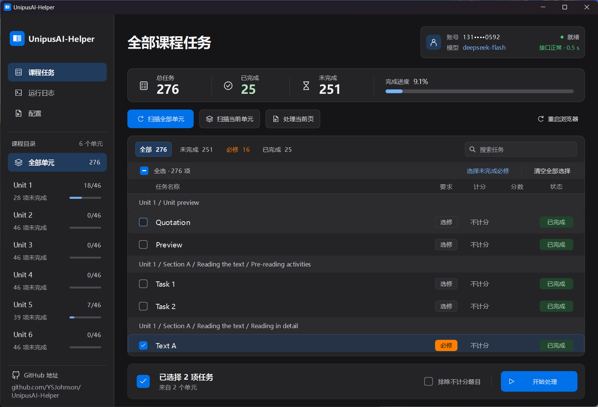
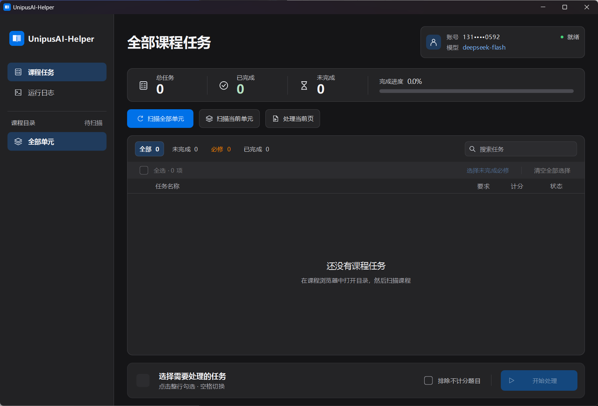
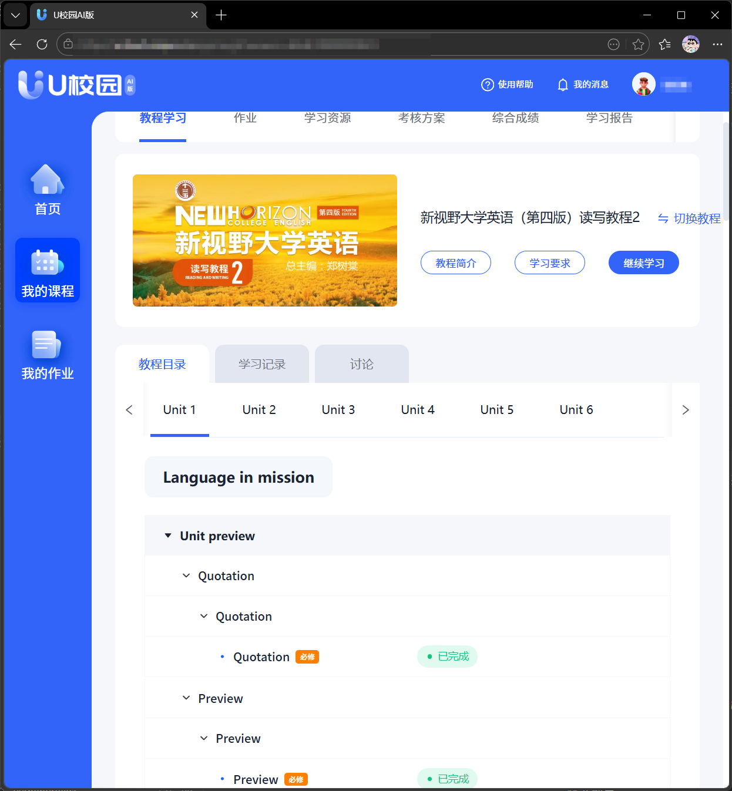
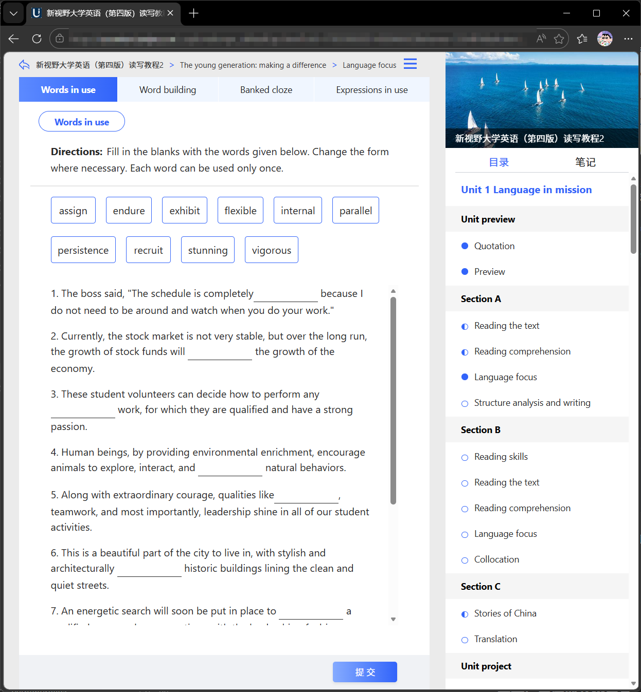
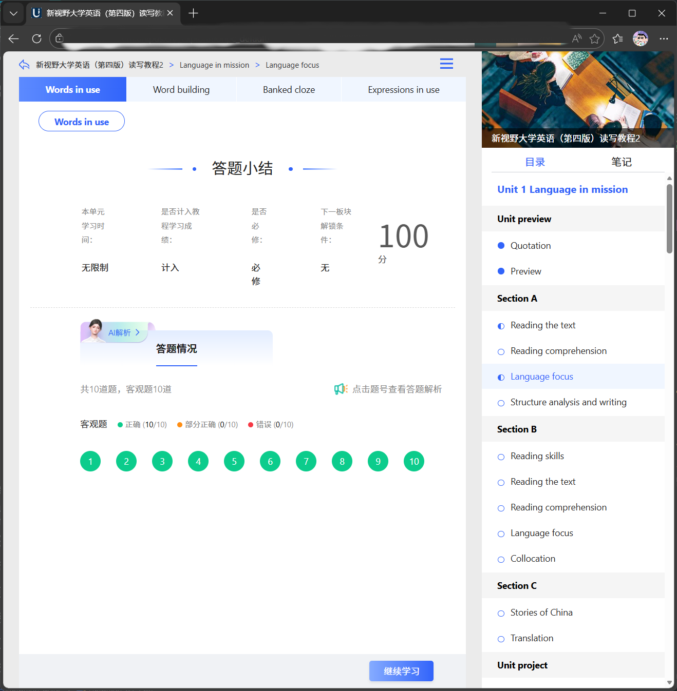

<h1 align="center">UnipusAI-Helper</h1>

<p align="center">
  
</p>

<p align="center">
  基于 Selenium、PySide6 / QML 与 OpenAI 兼容接口的 U 校园 AI 版自动化学习辅助工具
</p>

<p align="center">
  
  
  
  
  
  <a href="LICENSE"></a>
</p>

<p align="center">
  <a href="#特性">特性</a> ·
  <a href="#支持题型">支持题型</a> ·
  <a href="#快速开始">快速开始</a> ·
  <a href="#配置说明">配置说明</a> ·
  <a href="#使用指南">使用指南</a> ·
  <a href="#常见问题">常见问题</a> ·
  <a href="#更新日志">更新日志</a>
</p>

---

## 特性

- **原生桌面工作台**：基于 PySide6 / Qt Quick（QML），集中查看课程进度、任务状态、得分与运行日志，内置配置编辑器、手动 API 连通性检测与一键重启浏览器。
- **双代播放器适配**：同时兼容旧版（`course-v2`）与新版 ipublish（`course-v3`）教材页面，支持自动提交与低于达标分自动重做。
- **官方答案接口（实验性）**：默认开启。客观题优先获取并填写平台官方答案，命中时跳过原文读取、音频转写与 AI 调用，速度更快且支持零 AI 配置运行；主观题及未命中题目自动回落到 AI（未配置 AI 时自动跳过，不中断整批）。
- **音视频转写与口语录音**：通过本地 Whisper 转写听力与视频材料作为答题上下文；跟读题借用题目原声虚拟麦克风注入，主观口语题支持 AI 写稿 + TTS 合成语音作答；可选开启识图模式处理带图题目。
- **灵活调度与任务筛选**：支持扫描全部单元、扫描当前单元或直接处理当前页面；默认勾选未完成必修，支持关键词搜索、状态筛选与排除不计分任务，并提供实验性的三档跟读/录音自动跳过与客观题目标正确率控制。
- **断点续跑**：每完成一项自动取消勾选并更新状态；手动停止后保留剩余选择，再次开始即可继续处理。

---

## 支持题型

| 类别 | 已适配题型 | 处理方式 |
| --- | --- | --- |
| 客观选择与判断 | 单选、多选、判断、独立单元测试 | 自动解析题干与选项并点击作答 |
| 填空与词汇 | 普通填空、选词填空、下拉填空、首字母搭配填空、中文括注填空 | 自动读取同题组学习材料 / 词汇表作为上下文，扣除题面已给首字母前缀并分批作答 |
| 匹配与排序 | 人物 / 段落信息匹配、拖拽排序、React Flow 连线匹配 | 自动识别顺序与对应关系，模拟点击或拖拽完成 |
| 阅读与主观写作 | 阅读问答、翻译、写作、看视频写 Summary、讨论区发帖、自评量表 / 清单 | 结合阅读正文或音视频转写上下文生成答案并写入 |
| 音视频与口语录音 | 纯音视频学习、词汇卡 / 句子 / 段落跟读、主观口语录音、分页 / 带图口语题 | 完整播放音视频记录进度；跟读题注入原声、主观题通过 TTS 合成注入麦克风；带图题开启 `screenshot` 后交由多模态模型处理 |

> [!NOTE]
> **暂需手动处理的特殊题型**：AI 实时口语对话、附件 / 作品上传、部分小组讨论等任务会在日志中提示跳过，请在平台内手动完成。

---

## 快速开始

### 环境要求

- **操作系统**：Windows 10 / 11（主支持）、macOS（Apple Silicon / Intel 均可）
- **Python**：3.9 及以上（推荐 3.10–3.13）。
- **浏览器**：Microsoft Edge 或 Google Chrome。
- **FFmpeg**：用于本地音频转写。Windows 首次运行环境检查时可自动下载安装（约 130 MB）；macOS 需通过 Homebrew 安装。
- **大模型 API（可选）**：任意 OpenAI 兼容接口；留空时仍可通过官方答案接口完成客观题，需要 AI 的主观题或未命中题目会自动跳过。


### Windows

```powershell
git clone https://github.com/YSJohnson/UnipusAI-Helper.git
cd UnipusAI-Helper
py -m venv .venv
.venv\Scripts\python.exe -m pip install -r requirements.txt
.venv\Scripts\python.exe UnipusAI_Helper.py
```

已安装 [uv](https://docs.astral.sh/uv/) 的用户，也可以在现有 `.venv` 中快速安装依赖并检查兼容性：

```powershell
uv pip install --python .venv\Scripts\python.exe -r requirements.txt
uv pip check --python .venv\Scripts\python.exe
```

### macOS

先通过 Homebrew 安装运行依赖：

```bash
brew install ffmpeg                     # 语音转写需要
brew install --cask microsoft-edge      # 默认浏览器；使用 Chrome 可改为 google-chrome
```

克隆仓库后，任选以下一种方式启动：

- **方式一（推荐，使用辅助脚本自动初始化 `.venv` 并启动）**：

  ```bash
  git clone https://github.com/YSJohnson/UnipusAI-Helper.git
  cd UnipusAI-Helper
  bash scripts/UnipusAI-Helper.command
  ```

  也可以在访达中直接双击 `scripts/UnipusAI-Helper.command`。首次双击若提示「无法打开」，请右键选择「打开」，或在终端补上执行权限：`chmod +x scripts/UnipusAI-Helper.command`。

- **方式二（手动创建虚拟环境并运行）**：

  ```bash
  git clone https://github.com/YSJohnson/UnipusAI-Helper.git
  cd UnipusAI-Helper
  python3 -m venv .venv
  .venv/bin/pip install -r requirements.txt
  .venv/bin/python UnipusAI_Helper.py
  ```

### 更新项目

本地 `config.json` 已被 `.gitignore` 忽略，拉取更新不会覆盖你的本地配置：

```powershell
# Windows
git pull
.venv\Scripts\python.exe -m pip install -r requirements.txt
```

```bash
# macOS
git pull
.venv/bin/pip install -r requirements.txt
```

### 启动参数

如果环境已配置完成但因检测误判无法启动，可附加 `--skip-check` 跳过启动前环境检查：

```powershell
.venv\Scripts\python.exe UnipusAI_Helper.py --skip-check
```

---

## 配置说明

项目使用根目录下的 `config.json` 保存本地配置（已加入 `.gitignore`，请勿泄露或提交到公共仓库）。

- **首次启动**：若不存在 `config.json`，程序会自动弹出图形化配置窗口。填写账号和密码并保存后即可启动（大模型接口可按需选填）；关闭窗口则退出。
- **后续修改**：在工作台左侧栏点击 **「配置」** 即可随时修改，保存后**重新启动程序生效**。

完整配置模板：

```json
{
  "username": "",
  "password": "",
  "url": "https://uai.unipus.cn/sso/index.html?service=https%3A%2F%2Fucloud.unipus.cn%2Fhome",
  "api_key": "",
  "base_url": "",
  "model": "",
  "max_tokens": 32768,
  "temperature": 0.3,
  "record_score_threshold": 70,
  "score_threshold": 80,
  "target_accuracy": 100,
  "skip_record_mode": "off",
  "token_full": "",
  "debug_mode": false,
  "tts_engine": "auto",
  "tts_voice": "",
  "tts_proxy": "",
  "screenshot": false,
  "answer_api_enabled": true,
  "browser": "edge"
}
```

### 必填配置（2 项）

| 字段 | 说明 |
| --- | --- |
| `username` | U 校园 AI 版账号，用于自动登录 |
| `password` | U 校园 AI 版密码，用于自动登录 |

### 大模型 API 配置（可选）

仅完成官方答案接口覆盖的客观题时可全部留空；若需作答主观题、口语写稿或在官方答案未命中时自动回落 AI，请完整填写以下 3 项：

| 字段 | 说明 |
| --- | --- |
| `api_key` | 大模型接口密钥 |
| `base_url` | OpenAI 兼容接口地址，例如 `https://api.deepseek.com/v1`、`https://api.siliconflow.cn/v1`、`https://api.moonshot.cn/v1` |
| `model` | 对应接口支持的模型名称 |

<details>
<summary><b>展开查看进阶与可选配置</b></summary>

| 字段 | 默认值 | 说明 |
| --- | --- | --- |
| `url` | U 校园 SSO 地址 | 登录入口，留空或保持默认即可 |
| `max_tokens` | `32768` | 最大输出 token 数；代码层下限为 `32768`（避免推理型模型思考耗尽预算），若接口不支持会自动减半重试 |
| `temperature` | `0.3` | 生成温度（`0–2`），保持默认即可 |
| `record_score_threshold` | `70` | 录音、朗读及 My Voice 题型的自动重做达标分（`0–100`）；低于该分数时自动重做 |
| `score_threshold` | `80` | 其余题型的自动重做达标分（`0–100`）；低于该分数时自动重做 |
| `target_accuracy` | `100` | **[实验性]** 客观题目标正确率：`100` 表示关闭；可填单值（如 `85`）或区间（如 `"80-90"`）。开启后以官方答案或 AI 解为基准按题组配额做后处理控分，同时自动联动放宽重做下限并对新版播放器守住 60% 最低提交线 |
| `skip_record_mode` | `"off"` | **[实验性]** 自动跳过跟读/录音任务：`off`（不跳过）/ `follow_aloud`（仅跳过词汇/句子/段落跟读、角色扮演与配音，保留自由口语）/ `all`（跳过全部录音题）；跳过的任务取消本次勾选并保留未完成状态 |
| `browser` | `"edge"` | 浏览器后端：`edge` / `chrome`。环境检查、driver 启动与缓存目录均跟随此值；Chrome 仅检测提示，需自行安装 |
| `screenshot` | `false` | 是否将题目截图发送给模型；带图口语 / 听力题需开启并搭配支持识图的模型（会增加 token 消耗） |
| `tts_engine` | `"auto"` | 主观录音题语音合成后端：`auto`（默认，优先 `edge` 失败回退 `sapi`）/ `edge` / `sapi`（Windows 离线）/ `off` |
| `tts_voice` | `""` | TTS 音色名称；留空使用默认英语音色（`en-US-AriaNeural` 或系统英语语音） |
| `tts_proxy` | `""` | `edge-tts` 需要代理时填写，例如 `http://127.0.0.1:7890`；离线 `sapi` 无需配置 |
| `token_full` | `""` | 认证兜底；支持旧版完整 `__token` JSON 或 U 校园 5.0 的 JWT，正常登录时留空 |
| `answer_api_enabled` | `true` | **[实验性]** 是否启用官方答案接口；命中时客观题直接使用平台答案，置为 `false` 即纯 AI 作答 |
| `debug_mode` | `false` | 是否开启调试日志 |

</details>

---

## 使用指南

1. 完成基础配置并启动主程序，等待环境检查通过。
2. 程序会自动拉起浏览器并执行登录流程；如遇到验证码或人机验证，请在浏览器中手动完成。
3. 工作台右上角显示 **「就绪」** 即表示登录成功；若配置了大模型接口，可在右上角手动点击 **「测试接口」** 检查连通性。



4. 在浏览器中进入 `我的课程` → 选择目标课程，打开展示教程目录的页面。



5. 点击工作台顶部 **「扫描全部单元」** 读取整本教材任务（默认勾选**未完成必修**）；若只需处理浏览器当前所在单元，点击 **「扫描当前单元」**；如需跳过不计分任务，可勾选右下角 **「排除不计分题目」**。

6. 点击 **「开始处理」** 批量作答，启动后会自动切换到 **「运行日志」**。每完成一项会自动取消勾选并更新状态与得分；点击 **「停止处理」** 会保留剩余勾选，再次开始即可断点续跑；手动停止或出错时停留在日志页方便排查。

7. 如需直接处理单个页面，可手动在浏览器中打开目标题目（新版播放器滚动到对应题组即可），点击顶部 **「处理当前页」** 并确认；正常完成后同样会自动返回任务列表。



8. 作答完成后程序会在延迟数秒后自动提交。运行日志提示 **「已自动提交」** 即提交成功；若页面按钮结构特殊未命中，日志会提示 **「请手动提交」**。



---

## 常见问题

**部分教材或题型不适配 / 遇到异常怎么办？**

U 校园覆盖的教材版本较多，不同课程的页面结构与题型差异较大，适配仍在持续完善中。遇到跳过、填不进去、提交失败或程序报错时，欢迎通过 Issue 反馈，也欢迎提交 PR 一起完善。

**为什么 AI 做的个别题目分数偏低？**

部分题目强依赖前文、图片或听力材料等上下文；若某本教材尚未完全适配，可能存在上下文未完整提取的情况，模型只能仅凭题干作答。你可以先检查是否需要开启 `screenshot`（带图题）或调整 `score_threshold` / `record_score_threshold`，也可以在 Issue 中附上教材名称、单元任务点、题型截图和运行日志，方便定位修复。

**如何控制客观题正确率，以及自动跳过跟读任务？（实验性功能）**

> [!NOTE]
> 以下两项配置目前为**实验性功能**（默认关闭，尚未覆盖所有教材实机验证），如在具体课程中遇到异常或误判，欢迎携带日志提交 Issue 反馈。

- **目标正确率（`target_accuracy`）**：默认 `100`（关闭），可在「配置」窗口或 `config.json` 中设为单值（如 `85`）或区间（如 `80-90`）。该功能**不是**让大模型自己故意答错，而是先通过官方答案接口或 AI 获取正确解后，程序在填写前按当前页面/题组的客观小题数抽样配额，将抽中题目的答案改为合法的错误项（覆盖单选、多选、判断、排序、各类匹配以及下拉/选词/普通填空；主观写作、自评量表与录音题不扰动）。开启后会自动联动放宽客观题重做下限（`min(score_threshold, 目标下限 - 10)`），避免控分后又被低分重做刷回 100%；对新版播放器（`course-v3`）目标下限 ≥ 60 时会自动守住 60% 最低提交线。与官方答案接口配合使用时，以平台官方答案为基准抽样，正确率控制更准确。
- **自动跳过跟读/录音（`skip_record_mode`）**：默认 `off`（不跳过），可设为 `follow_aloud`（仅跳过词汇/句子/段落跟读、角色扮演与视频配音，保留自由口语录音）或 `all`（跳过全部口语/录音题）。纯跟读任务跳过后会取消本次勾选并保留“未完成”状态，继续处理剩余任务；混合页面会跳过其中的跟读小题并继续提交其他题型。

**官方答案接口取不到答案、不配置大模型 API，或者想只用大模型作答怎么办？**

接口仅覆盖客观题（选择、判断、填空、排序、匹配、下拉），主观题仍需 AI。遇到未命中、网络异常或缺少 `pycryptodome` 依赖时：已配置大模型会自动回落到 AI 作答；未配置大模型则自动跳过该任务（保留未完成状态）并继续处理后续任务，不会中断整批。如需完全使用纯 AI 作答，在「配置」窗口取消勾选 **「启用官方答案接口（实验性）」**，或在 `config.json` 中将 `answer_api_enabled` 设为 `false` 后重启即可。

**带图口语题或听力图片题答不出来怎么办？**

请在配置中将 `screenshot` 设为 `true`（或在「配置」窗口勾选“识图模式”），并换用支持视觉理解的多模态模型，保存后重启程序。注意开启识图会发送页面截图，token 消耗会相应增加。

**录音题没有声音，或 `edge-tts` 提示 403 / 连接失败怎么办？**

1. 确认已更新依赖，保证 `edge-tts >= 7.3.1`（旧版本会触发接口 403）。
2. 如网络访问微软语音服务受限，可在配置中填写 `tts_proxy`（例如 `http://127.0.0.1:7890`）。
3. Windows 用户也可以直接将 `tts_engine` 设为 `sapi`，使用系统自带语音离线合成。

**首次处理听力 / 视频题等待时间较长正常吗？**

正常。首次遇到需要语音转写的题目时，程序会自动下载并加载本地 Whisper `base` 模型（约 140 MB），受网络与设备性能影响需要一定时间；下载完成后会保存在本地缓存中，后续处理会明显加快。

**为什么使用 Selenium 模拟浏览器操作，而不是直接调用接口上报进度？**

直接上报进度虽然更快，但平台可能存在风控与检测机制，面临更高的账号与合规风险。本项目通过 Selenium 尽量按照平台原有的学习与作答流程交互，速度相对慢一些，但更稳妥、可控。另外，选用响应速度较快的模型整体体验会更流畅。推荐deepseek-flash。

**为什么目前没有提供安装包或便携包？**

项目早期曾在 Release 中提供过打包版本，但语音识别依赖 FFmpeg、Whisper 与 PyTorch，完整安装包体积较大；每次迭代都需要重新构建，用户更新时也必须重复下载未变化的重型依赖，效率远低于源码运行。使用源码运行完成初次环境配置后，后续只需 `git pull` 拉取变更文件即可快速更新。如后续有更合适的分发方案会考虑恢复 Release。

---

## 项目目录结构

```text
UnipusAI-Helper/
├── UnipusAI_Helper.py          # 主程序入口与作答核心逻辑
├── config.example.json         # 配置模板
├── requirements.txt            # Python 依赖清单
├── README.md                   # 项目说明
├── CHANGELOG.md                # 完整更新日志
├── LICENSE                     # AGPLv3 协议
├── unipus_helper/              # 业务模块与原生界面
│   ├── accuracy_control.py     # 客观题目标正确率配额与后处理扰动
│   ├── answer_api.py           # 官方答案接口获取与本地缓存
│   ├── audio_recognizer.py     # 本地 Whisper 音频转写
│   ├── browser.py              # Edge / Chrome 后端检测与启动
│   ├── environment_checker.py  # 运行环境与 FFmpeg 检查
│   ├── course_catalog.py       # 课程目录扫描
│   ├── record_skip.py          # 跟读/录音任务三档跳过策略
│   ├── task_grading.py         # 计分状态识别与筛选
│   ├── workbench_controller.py # 任务状态、调度与日志管理
│   ├── native_ui.py            # Python / QML 桥接与配置保存
│   ├── paths.py                # 项目与资源路径解析
│   └── qml/                    # Qt Quick / QML 界面、主题与图标
├── scripts/                    # macOS 快捷启动脚本
└── docs/images/                # README 界面与流程截图
```

---

## 更新日志

近期版本摘要（完整记录见 [CHANGELOG.md](CHANGELOG.md)）：

- **v3.9.19（2026-11-27）**：修复长文本框不自动聚焦输入与视频任务重复播放问题（issue #75），并补齐新版单元测试选词填空与翻译题型适配（issue #74）：改为瞬时滚动并校验焦点与清空状态、超 120 字改用原生 setter 快速写入、失败时输出长度/maxlength/焦点诊断；为视频预处理增加一次性完成标记以消除重复播放。
- **v3.9.18（2026-11-26）**：修复批量切换 Unit 超时与长文本提交确认超时（issue #73）：支持课程目录慢加载自动重载与完整状态诊断、同模板 Unit 切换防超时、长文本 iCorrect 异步评测延长等待至 60s、弹窗容器化分类处理及 My voice 附件上传完成校验。
- **v3.9.17（2026-11-26）**：新增实验性官方答案接口（`answer_api_enabled`，默认开启），客观题优先直填平台答案并跳过不必要的原文读取与音频转写、支持与 `target_accuracy` 配合控分；大模型 API 改为可选（未配置时需 AI 任务自动跳过），右上角模型检测改为手动触发。
- **v3.9.16（2026-11-25）**：新增客观题目标正确率控制（`target_accuracy`）与三档自动跳过跟读/录音任务（`skip_record_mode`）两项实验性功能（issue #66）。

---

## 致谢

- 感谢开源社区提供的优秀工具与生态。
- 感谢 [UnipusAI](https://github.com/Zzj-klwgxdz/UnipusAI) 项目作者 [Zzj-klwgxdz](https://github.com/Zzj-klwgxdz)，本项目早期借鉴了其解析器框架思路与登录认证状态处理机制。
- 感谢 [MyUserScripts](https://github.com/SSmJaE/MyUserScripts)（[SSmJaE](https://github.com/SSmJaE)）与 [UnipusHelperPro](https://github.com/Duster-Cule/UnipusHelperPro)（[Duster-Cule](https://github.com/Duster-Cule)，MIT License © 2025 Duster-Cule），本项目官方答案接口的解密与认证方案参考了上述开源项目的公开思路。
- 感谢 [TG 小树屋](https://t.me/xiaoshuwu/9057) 对本项目的推荐。
- 感谢所有提交 Pull Request、反馈未适配教材与协助复现验证的社区贡献者。

<a href="https://github.com/YSJohnson/UnipusAI-Helper/graphs/contributors">
  
</a>

---

## 🌟 Star History

如果这个项目对你有帮助，欢迎点一个 Star 支持一下！这对我非常重要！

[](https://www.star-history.com/#YSJohnson/UnipusAI-Helper&Date)

---

## License

本项目采用 **GNU Affero General Public License v3.0 (AGPLv3)** 开源协议，详见 [LICENSE](LICENSE)。  
你可以自由使用、修改和分发本项目，但任何修改版或衍生作品必须以相同的 AGPLv3 协议开源；即使作为网络服务运行（SaaS），也必须向用户公开完整的源代码。

> [!WARNING]
> 本项目仅用于 Python 自动化、Web 页面交互、语音识别与大模型接口接入的学习研究。请遵守学校、课程平台及相关法律法规，切勿将其用于违反平台规则或影响教学公平的用途。
